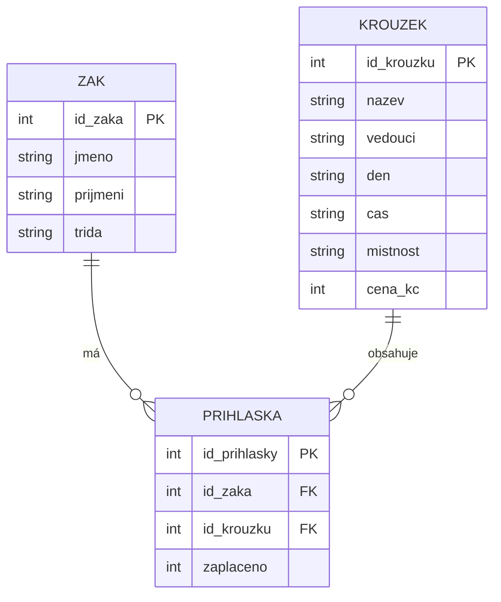

# SP1 Kroužky
**26:** 

## Tři problémy původní tabulky
1. **Redundance (nadbytečné opakování dat):** Údaje o žácích a kroužcích se zbytečně opakovaly s každou novou přihláškou. To vede k plýtvání místem.
2. **Nekonzistence dat (různé zápisy téže věci):** Stejné hodnoty byly pokaždé zapsány jinak (např. střídání velikosti písmen v "Robotika / robotika" nebo chybějící tituly u učitelů).
3. **Anomálie při mazání a vkládání:** Pokud se odhlásí poslední žák, smaže se s ním i informace o existenci samotného kroužku. Nelze založit kroužek bez žáků.

## Seznam entit a klíčů
* **ZAK:** PK = `id_zaka`
* **KROUZEK:** PK = `id_krouzku`
* **PRIHLASKA:** PK = `id_prihlasky`, FK = `id_zaka`, FK = `id_krouzku`

## ER Diagram



## SQL Dotaz
```sql
SELECT nazev, cena_kc 
FROM krouzky 
WHERE cena_kc > 500;
```